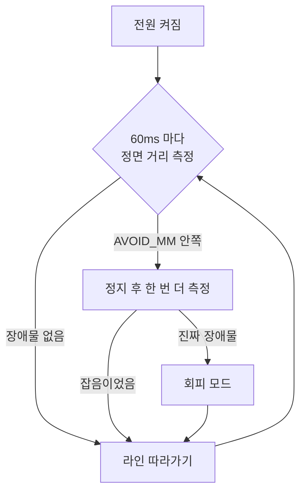
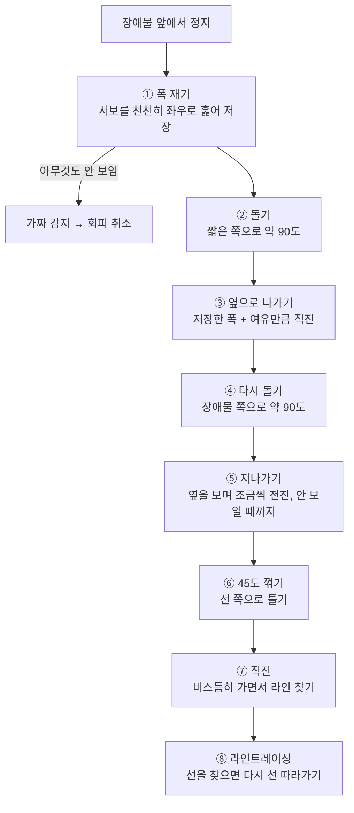

# 🚗 4WD RC카 — 라인트레이서 + 초음파 장애물 회피

> **✅ 동작 확인 완료** — 라인 주행과 장애물 회피(①~⑧)가 이 차에서 끝까지 동작합니다.
> 다른 차에 올릴 때는 아래 **튜닝** 의 회전 시간과 라인센서 감도를 다시 맞추세요.

아두이노 우노로 만든 4륜 RC카입니다. 흰 선을 따라 달리다가 장애물을 만나면,
**초음파 센서 하나와 서보 하나만으로** 장애물 크기를 재고 옆으로 돌아서 다시 선으로 복귀합니다.

엔코더도 IMU도 없어서 "얼마나 갔는지 / 몇 도 돌았는지"를 전부 시간으로 추정합니다.

---

## 🛣️ 트랙에 맞는 버전 고르기

트랙 색에 따라 라인센서가 선을 읽는 방법이 반대라서, 버전이 두 개입니다. **동작과 설정은 똑같고, 라인센서 값을 읽는 방법만 다릅니다.**

| 트랙 | 주행용 (시리얼 없음) | 디버그용 (시리얼 있음) | 상태 |
|---|---|---|---|
| ⬛ 어두운 바탕 + ⬜ **흰 선** | `RC_CAR_WHITE_LINE/RC_CAR_WHITE_LINE.ino` | `RC_CAR_WHITE_LINE_DEBUG/RC_CAR_WHITE_LINE_DEBUG.ino` | ✅ 실차 테스트 완료 (v1.0) |
| ⬜ 밝은 바탕 + ⬛ **검은 선** | `RC_CAR_BLACK_LINE/RC_CAR_BLACK_LINE.ino` | `RC_CAR_BLACK_LINE_DEBUG/RC_CAR_BLACK_LINE_DEBUG.ino` | 🧪 아직 실차 테스트 전 |

- **검은 선 버전의 라인 따라가기는 센서 값 그대로(검은 선 = `1`) 씁니다.**

  | 왼쪽 | 가운데 | 오른쪽 | 동작 (검은 선 버전) |
  |:---:|:---:|:---:|---|
  | 0 | 1 | 0 | 직진 |
  | 0 | 1 | 1 | 오른쪽으로 크게 보정 |
  | 0 | 0 | 1 | 오른쪽으로 살짝 보정 |
  | 1 | 1 | 0 | 왼쪽으로 크게 보정 |
  | 1 | 0 | 0 | 왼쪽으로 살짝 보정 |
  | 1 | – | 1 | 0.5초(`LINE_GRACE_MS`) 동안 하던 동작 유지, 그 뒤 정지 |
  | 0 | 0 | 0 | 선 놓침 → 2초(`LOST_STOP_MS`) 동안 하던 동작 유지, 그 뒤 정지 |

- 회피 동작과 나머지 설정은 흰 선 버전과 같습니다.
- 트랙을 바꾸면 **라인센서 감도(가변저항)를 그 트랙에서 다시 맞추세요.**

---

## 📁 파일

파일 이름만 보고 **트랙(흰 선 / 검은 선)** 과 **용도(주행 / 디버그)** 를 알 수 있게 나눠 두었습니다.

```
RC_CAR_WHITE_LINE/          흰 선 · 주행용   (시리얼 없음, 가장 빠름)
RC_CAR_WHITE_LINE_DEBUG/    흰 선 · 디버그용 (시리얼 9600 baud, 단계별 로그)
RC_CAR_BLACK_LINE/          검은 선 · 주행용
RC_CAR_BLACK_LINE_DEBUG/    검은 선 · 디버그용
TURN_TEST/                  회전 시간 맞추기 테스트
docs/                       README 그림
```

- **주행용** 은 출력이 없어서 가장 빠릅니다. 실제로 달릴 때 씁니다.
- **디버그용** 은 단계별 로그(`[1 폭 재기]` ~ `[8 라인트레이싱]`)를 시리얼로 찍습니다. 출력 때문에 조금 느립니다.
- **검은 선** 버전은 라인센서 값을 뒤집어 읽는 것(`readLine()`)만 다르고, 나머지 동작과 설정은 흰 선 버전과 같습니다.

> 트랙이 바뀌면 라인센서 감도(가변저항)도 그 트랙에서 다시 맞춰야 합니다.
>
> 설정값을 바꾸면 각 버전에 **똑같이** 옮겨 적으세요. 파일들의 `[설정]` 값이 같아야 같은 동작을 합니다.

---

## 🧩 구성

**사용 키트 : 에듀이노(Eduino) 4휠 스마트 RC카** (Arduino UNO 기반)
키트의 차체·모터·센서·배선을 그대로 쓰고, 코드는 키트 예제가 아니라 새로 작성했습니다.


| 부품 | 핀 | 용도 |
|---|---|---|
| 라인센서 ×3 (TCRT5000) | A5(왼쪽) · A4(가운데) · A3(오른쪽) | 흰 선 = `0`, 검은 바탕 = `1` |
| 초음파 센서 | Trig 13 · Echo 12 | 장애물까지 거리(mm) |
| 서보 | 2 | 초음파 센서를 좌우로 돌림 |
| 모터 드라이버 | PWM 5 · 6 / 방향 8 · 9 · 10 · 11 | 좌우 바퀴 |

---

## 🔁 전체 흐름



라인센서는 쉬지 않고 계속 읽고, 초음파는 60ms 마다만 쏩니다.
(너무 자주 쏘면 앞에 쏜 소리의 메아리가 섞여서 가짜 값이 나옵니다.)

### 달리면서 재는 것 / 멈춰서 재는 것

| 언제 | 무엇을 재나 | 차 상태 |
|---|---|---|
| 라인 주행 중 | 정면에 뭐가 있는지만 (60ms 마다 한 번) | **달리는 중** — 멈추지 않음 |
| 장애물이 `AVOID_MM` 안쪽에 나타남 | 한 번 더 재서 진짜인지 확인 | **멈춤** |
| 진짜 장애물 | 서보로 좌우를 훑어 폭 측정, 이후 회피 중 모든 측정 | **멈춤** |
| 가짜 값(잡음) | – | 바로 다시 출발 |

달리면서 재는 건 "앞에 뭐가 있나"만 보는 가벼운 확인이고,
폭처럼 정확해야 하는 측정은 전부 멈춘 뒤에 합니다.

---

## 〰️ 라인 따라가기

센서 3개 값(왼쪽, 가운데, 오른쪽)의 조합으로 동작을 고릅니다.
선에서 벗어난 만큼 방향을 **보정**하는 것이고, 회전(좌회전·우회전)은 장애물 회피에서만 씁니다.

> **흰 선 버전 기준** : **`0` = 선을 인식함**, `1` = 검은 바탕 (선 없음). 검은 선 버전 표는 위 "트랙에 맞는 버전 고르기" 에 있습니다.

| 왼쪽 | 가운데 | 오른쪽 | 동작 |
|:---:|:---:|:---:|---|
| 1 | 0 | 1 | 직진 |
| 1 | 0 | 0 | 왼쪽으로 살짝 보정 |
| 1 | 1 | 0 | 왼쪽으로 크게 보정 (제자리에서 틀기) |
| 0 | 0 | 1 | 오른쪽으로 살짝 보정 |
| 0 | 1 | 1 | 오른쪽으로 크게 보정 (제자리에서 틀기) |
| 0 | – | 0 | 정지 |
| 1 | 1 | 1 | 선 놓침 → 하던 동작 유지, 20초 지나면 정지 |

---

## 🧱 장애물 회피 알고리즘

핵심은 **"먼저 재고, 그다음에 움직인다"** 입니다.
움직이면서 그때그때 본 값으로 판단하면 센서 값이 한 번만 튀어도 엉뚱하게 꺾이기 때문입니다.



오른쪽으로 피하는 경우를 위에서 본 그림입니다. 차는 아래에서 위로 선을 따라 달립니다.
왼쪽으로 피할 때는 좌우만 뒤집힌 같은 경로입니다.

<p align="center">
  
</p>

### 단계별 설명

1. **폭 재기** — 서보를 정면 기준 ±70도까지 10도씩 천천히 돌리며 거리를 잽니다.
   장애물로 보이는 각도에서 `거리 × sin(각도)` 로 좌우로 뻗은 길이를 구해 저장합니다.
2. **돌기** — 왼쪽·오른쪽 중 짧게 뻗은 쪽으로 약 90도 돕니다. 이제 장애물은 차의 옆에 있습니다.
3. **옆으로 나가기** — 저장한 폭 + 여유만큼은 무조건 직진합니다. 그 뒤에도 옆에 장애물이 보이면 6cm씩 더 갑니다.
4. **다시 돌기** — 장애물 쪽으로 약 90도 돌아 원래 진행 방향으로 섭니다. 장애물은 여전히 같은 쪽 옆에 있습니다.
5. **지나가기** — 서보로 옆을 보면서 6cm 전진 → 정지 → 측정을 반복합니다. 옆에 안 보이면 다 지나간 것입니다.
6. **45도 꺾기** — 선 쪽으로 45도 틉니다.
7. **직진** — 비스듬히 직진하면서 라인센서로 선을 찾습니다.
8. **라인트레이싱** — 선을 찾으면 원래 방향으로 돌아 선 위에 정렬하고, 평소의 라인 따라가기로 돌아갑니다.

### 지키는 규칙

- **서보로 잴 때는 반드시 멈춘 상태** — 측정 함수(`lookAt`)가 무조건 먼저 정지하고, 차가 완전히 설 때까지 기다린 뒤 잽니다.
- **가짜 값 거르기** — 20mm 미만 값은 버리고(센서가 잴 수 없는 거리), 장애물이 보이면 한 번 더 재서 확인합니다.
- **멈춰 서지 않기** — 회피가 끝났는데 선이 안 보이면 전진하면서 찾습니다.

---

## 🎛️ 튜닝

조절하는 값은 전부 각 `.ino` 파일 맨 위 **`[설정]`** 블록에 있습니다. 먼저 맞춰야 하는 값은 회전 시간과 이동 거리입니다.

| 값 | 뜻 | 맞추는 법 |
|---|---|---|
| `TURN_RIGHT_90_MS` · `TURN_LEFT_90_MS` | ②④ 90도 도는 시간(ms), 방향별 | `TURN_TEST.ino` 로 재서 맞추기 |
| `TURN_RIGHT_45_MS` · `TURN_LEFT_45_MS` | ⑥ 45도 도는 시간(ms), 방향별 | 〃 |
| `AVOID_TURN_SPEED` | 회피 회전 속도 (멈춘 상태에서 돌기 시작하므로 라인 보정보다 셈) | 회전이 안 되면 올리기 |
| `MM_PER_SEC` | 1초에 가는 거리(mm). 장애물 폭처럼 재서 정해지는 거리를 시간으로 바꿀 때만 씀 | 1초 직진시켜 자로 재기 |

회전 시간은 오른쪽·왼쪽을 따로 정해 둡니다. 차가 좌우로 도는 힘이 달라서 같은 각도라도 시간이 다르게 나옵니다.
건전지가 약해지면 다시 맞춰야 합니다.

### 회전 시간 맞추기 (`TURN_TEST`)

> **⚠️ 회전 시간은 차마다 다릅니다.** 모터, 바퀴, 건전지 상태, 바닥에 따라 같은 시간이라도 도는 각도가 달라집니다.
> 코드에 들어 있는 값(오른쪽 90° 550ms · 왼쪽 90° 900ms · 45° 500ms, 속도 170)은 **이 차에서 잰 값**이니,
> 다른 차에 올릴 때는 반드시 `TURN_TEST` 로 다시 맞추세요.

회전 시간은 [`TURN_TEST/TURN_TEST.ino`](TURN_TEST/TURN_TEST.ino) 로 따로 맞춥니다. 모터 배선과 회전 속도는 본 코드와 같습니다.

1. `TURN_TEST.ino` 를 업로드하고 시리얼 모니터를 **9600 baud** 로 엽니다.
2. 바닥에 테이프로 차 방향을 표시합니다. (실제 트랙 바닥에서 해야 마찰이 같습니다.)
3. 한 글자씩 보내서 돌려보고, 덜 돌면 `+`, 더 돌면 `-` 로 20ms씩 고칩니다.

| 입력 | 동작 |
|:---:|---|
| `r` / `l` | 오른쪽 / 왼쪽 90도 |
| `e` / `q` | 오른쪽 / 왼쪽 45도 |
| `+` / `-` | 방금 돌린 값 ±20ms |
| `p` | 지금 값 전부 출력 |

4. 다 맞으면 `p` 로 나온 숫자를 쓰는 `.ino` 파일들의 `TURN_RIGHT_90_MS` · `TURN_LEFT_90_MS` · `TURN_RIGHT_45_MS` · `TURN_LEFT_45_MS` 에 옮겨 적습니다.

전원을 끄면 값이 처음으로 돌아가니, 끄기 전에 `p` 로 꼭 확인하세요.

### 라인센서 감도 맞추기 (가변저항)

라인센서 3개에는 각각 **감도 조절용 가변저항(파란 나사)** 이 있습니다. 이것도 **차마다, 바닥마다 다르니** 처음에 꼭 맞춰야 합니다.

1. 센서 하나씩 **흰 선 위** 에 두고, 센서 모듈의 표시등(LED)이 바뀌는지 봅니다.
2. **검은 바탕 위** 로 옮겨서 표시등이 반대로 바뀌는지 봅니다.
3. 안 바뀌면 그 센서의 가변저항을 드라이버로 조금씩 돌리며 다시 봅니다.
4. 세 개 모두 선 위 / 바탕 위에서 표시등이 확실히 바뀌면 끝.

- 센서와 바닥 사이 높이가 바뀌면(바퀴·조립 변경) 다시 맞춰야 합니다.
- 조명이 밝은 곳(햇빛)에서는 값이 흔들릴 수 있으니, 실제로 달릴 장소에서 맞추세요.

그 밖에 자주 만지는 값입니다. 고정된 움직임은 전부 **ms(1000 = 1초)** 로 정해져 있습니다.

| 값 | 뜻 |
|---|---|
| `AVOID_MM` | 이 거리 안에 장애물이 보이면 회피 시작 |
| `AVOID_SIDE` | `0` 자동 · `1` 무조건 오른쪽 · `2` 무조건 왼쪽 (한쪽씩 테스트할 때) |
| `SERVO_FLIP` | 서보 좌우가 반대로 달렸으면 `1` |
| `SIDE_MARGIN_MM` | 옆으로 나갈 때 장애물 폭에 더하는 여유. 긁히면 늘리기 |
| `PASS_STEP_MS` | 지나갈 때 한 번에 전진하는 시간 (전진 → 정지 → 옆 확인) |
| `PASS_EXTRA_MS` | 장애물이 안 보이게 된 뒤 더 가는 시간 |
| `RETURN_MAX_MS` | 45도 꺾고 선 찾으며 직진하는 최대 시간 |

---

## 📌 할 일

- [x] 라인 주행
- [x] 장애물 회피 ①~⑧ (오른쪽 90° 550ms · 왼쪽 90° 900ms · 45° 500ms, 회피 회전 속도 170)
- [x] 회전 시간 테스트 코드 (`TURN_TEST`)
- [x] 디버그 출력 제거, 코드 단순화
- [ ] 다른 차·다른 바닥에서 회전 시간과 라인센서 감도 다시 맞추기
