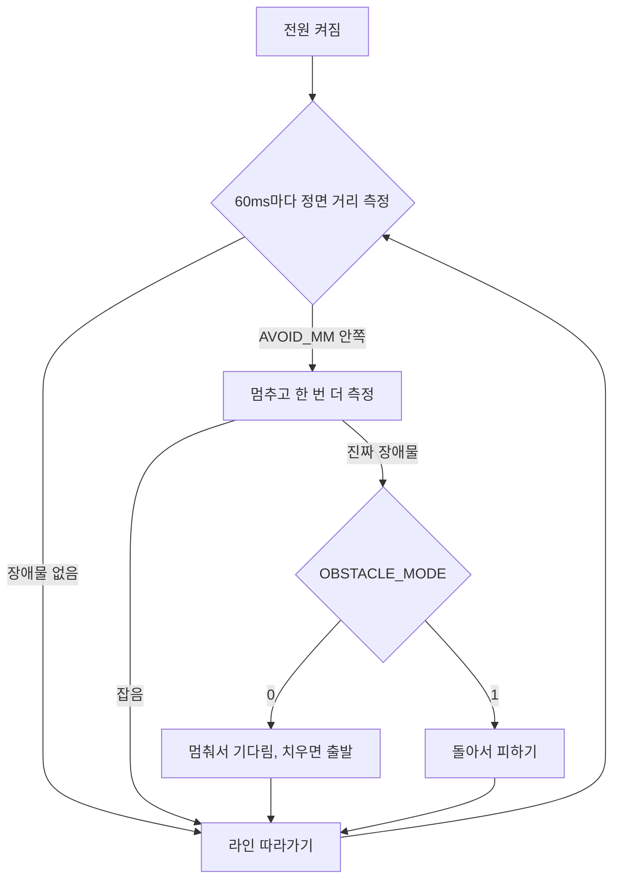
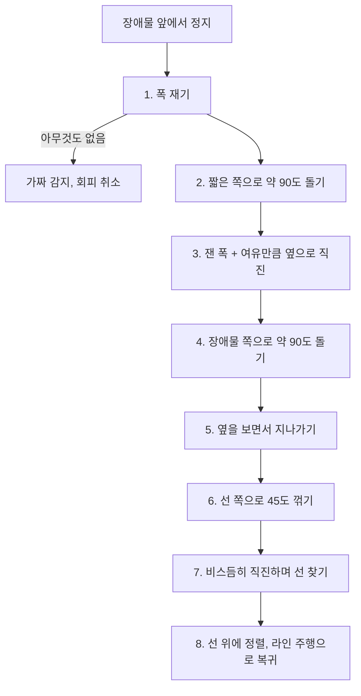
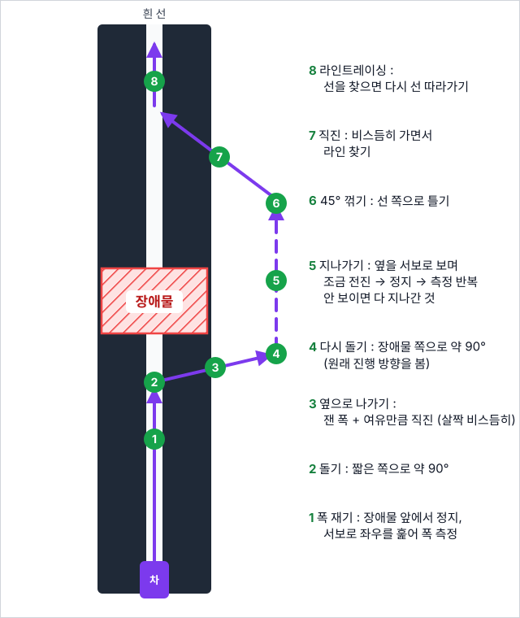

# 4WD RC카 라인트레이서 + 초음파 장애물 회피

에듀이노(Eduino) 4휠 스마트 RC카 키트(Arduino UNO)로 만든 라인트레이서.
선을 따라 달리다가 장애물을 만나면 초음파 센서 하나와 서보로 장애물 폭을 재고, 옆으로 돌아서 다시 선으로 돌아온다.
차체·모터·센서·배선은 키트 그대로 쓰고 코드는 새로 짰다.

엔코더나 IMU가 없어서 이동 거리와 회전 각도는 전부 시간으로 정한다. 그래서 차마다, 건전지 상태마다 값을 다시 맞춰야 한다.

## 파일

```
RC_CAR_WHITE_LINE/          어두운 바탕 + 흰 선, 주행용
RC_CAR_WHITE_LINE_DEBUG/    어두운 바탕 + 흰 선, 디버그용 (시리얼 출력)
RC_CAR_BLACK_LINE/          밝은 바탕 + 검은 선, 주행용
RC_CAR_BLACK_LINE_DEBUG/    밝은 바탕 + 검은 선, 디버그용 (시리얼 출력)
TURN_TEST_WHITE_LINE/       회전 시간 맞추기, 어두운 책상 + 흰 테이프
TURN_TEST_BLACK_LINE/       회전 시간 맞추기, 밝은 책상 + 검은 테이프
docs/                       README 그림
```

| 트랙 | 상태 |
|---|---|
| 어두운 바탕 + 흰 선 | 실차 테스트 완료 (v1.0) |
| 밝은 바탕 + 검은 선 | 테스트 중 |

- 주행용은 시리얼 출력이 없어서 제일 빠르다. 실제로 달릴 때는 이걸 쓴다.
- 디버그용은 시리얼 모니터(9600 baud)에 단계별 로그를 찍는다. 출력 때문에 조금 느리다.
- 설정값을 바꾸면 같은 트랙의 주행용과 디버그용에 똑같이 적어야 같은 동작을 한다.
- 트랙을 바꾸면 라인센서 감도(가변저항)를 그 트랙에서 다시 맞춰야 한다.

## 하드웨어

| 부품 | 핀 | 비고 |
|---|---|---|
| 라인센서 3개 (TCRT5000) | 실제 위치 : A3 왼쪽, A4 가운데, A5 오른쪽 | 흰색 = 0, 검은색 = 1 |
| 초음파 센서 | Trig 13, Echo 12 | 거리(mm) |
| 서보 | 2 | 초음파 센서를 좌우로 돌림 |
| 모터 드라이버 | PWM 5, 6 / 방향 8, 9, 10, 11 | 좌우 바퀴 |

## 동작 흐름



라인센서는 계속 읽고, 초음파는 60ms 간격으로만 쏜다. 너무 자주 쏘면 앞에서 쏜 소리의 메아리가 섞여서 가짜 값이 나온다.

달리는 중에는 정면에 뭐가 있는지만 확인하고 멈추지 않는다. 장애물이 보이면 멈춘 다음 한 번 더 재서 확인하고, 회피 중의 측정(폭 재기, 옆 확인)은 전부 멈춘 상태에서 한다.

## 라인 따라가기

### 흰 선 버전 (선 = 0)

흰 선 코드는 A5를 "왼쪽", A3를 "오른쪽"이라고 부른다(실제와 반대). 대신 아래 표도 그에 맞춰 반대로 짜여 있어서 실제로는 선이 있는 쪽으로 맞게 꺾는다. 표의 왼쪽/오른쪽은 코드 이름 기준이다.

| 왼쪽 | 가운데 | 오른쪽 | 동작 |
|:---:|:---:|:---:|---|
| 1 | 0 | 1 | 직진 |
| 1 | 0 | 0 | 왼쪽으로 살짝 보정 |
| 1 | 1 | 0 | 왼쪽으로 크게 보정 (제자리에서 틀기) |
| 0 | 0 | 1 | 오른쪽으로 살짝 보정 |
| 0 | 1 | 1 | 오른쪽으로 크게 보정 (제자리에서 틀기) |
| 0 | - | 0 | 정지 |
| 1 | 1 | 1 | 선 놓침. 좌우로 흔들며 찾기 (아래 참고) |

### 검은 선 버전 (선 = 1, 센서 값 그대로)

검은 선 코드는 핀을 실제 위치대로 쓴다(왼쪽 A3, 오른쪽 A5). 센서 두 개(가운데 + 한쪽)가 선을 보면 그쪽으로 살짝 보정, 한쪽 센서 하나만 보면 그쪽으로 회전한다.

| 왼쪽 | 가운데 | 오른쪽 | 동작 |
|:---:|:---:|:---:|---|
| 0 | 1 | 0 | 직진 |
| 0 | 1 | 1 | 오른쪽으로 살짝 보정 |
| 0 | 0 | 1 | 오른쪽으로 크게 보정 (코너) |
| 1 | 1 | 0 | 왼쪽으로 살짝 보정 |
| 1 | 0 | 0 | 왼쪽으로 크게 보정 (코너) |
| 1 | - | 1 | 0.5초(`LINE_GRACE_MS`) 동안 하던 동작 유지, 그 뒤 정지 |
| 0 | 0 | 0 | 선 놓침. 좌우로 흔들며 찾기 (아래 참고) |

검은 선 버전은 속도 설정도 다르다(직진 `SPEED` 100, 크게 보정 `TURN_SPEED` 110, 코너 `CORNER_SPEED` 140). 코너(끝 센서 하나만 선을 봄)에서는 가운데 센서가 선을 다시 볼 때까지 확실히 돌고, 찾으면 바로 전진한다.

키트 PDF의 라인트레이서 예제(9_RC_CAR_Line)도 검은 절연테이프 트랙 기준이고, 방향(오른쪽 센서가 선을 보면 오른쪽으로)은 이 버전과 같다. 여기에 살짝/크게 구분, 코너에서 놓쳤을 때 찾기, 양쪽 동시 인식 유효 시간을 더했다.

절연테이프는 표면이 반짝여서 적외선을 반사하는 경우가 있다. 그러면 센서가 검은 선을 흰색으로 읽는다. 무광 테이프를 쓰거나 테이프 위에서 감도를 다시 맞춘다.

### 선을 놓쳤을 때

코너든 직선이든 선을 놓치면 제자리에서 좌우로 머리를 흔들며 찾는다.

- 마지막으로 선이 있던 쪽부터 흔든다. 모르면 왼쪽부터.
- 가운데를 지나 반대쪽으로 갈 때마다 폭을 넓힌다 (`SWAY_START_MS`에서 시작해 `SWAY_GROW_MS`씩. 흰 선 250ms / 150ms씩 속도 190, 검은 선 320ms / 190ms씩 속도 150).
- 흔드는 중에 센서 하나라도 선을 보면 멈추지 않고 바로 전진하면서 라인 주행으로 돌아간다.
- `SWAY_MAX_MS`(3초) 안에 못 찾으면 멈추고, 선이 다시 보일 때까지 서 있는다.

## 장애물을 만났을 때

`OBSTACLE_MODE`로 고른다.

- `0` (기본) : 장애물 앞에서 멈추고, 치울 때까지 기다렸다가 다시 출발한다. 60ms 간격으로 재서 `CLEAR_COUNT`(5)번 연속 장애물이 안 보이면 치운 걸로 보고, `CLEAR_WAIT_MS`(0.5초) 뒤에 출발한다.
- `1` : 아래 "장애물 회피" 1~8단계로 돌아서 피한다.

초음파는 20mm보다 가까운 건 못 잰다. 장애물을 차에 바짝 붙여 두면 안 보이는 걸로 읽혀서 출발할 수 있다.

## 장애물 회피 (OBSTACLE_MODE = 1)

움직이면서 그때그때 판단하면 센서 값 하나만 튀어도 엉뚱하게 꺾여서, 멈춰서 먼저 재고 그 값대로 움직이게 했다.



오른쪽으로 피하는 경우를 위에서 본 그림. 차는 아래에서 위로 달린다. 왼쪽으로 피할 때는 좌우만 반대다.

<p align="center">
  
</p>

1. 폭 재기: 서보를 정면 기준 ±70도까지 10도씩 돌리며 거리를 잰다. 장애물로 보이는 각도에서 `거리 × sin(각도)`로 좌우로 뻗은 길이를 구해 저장한다.
2. 돌기: 짧게 뻗은 쪽으로 약 90도 돈다. 시간으로 도는 거라 딱 90도는 아니고 조금 비스듬하다.
3. 옆으로 나가기: 저장한 폭 + 여유만큼은 무조건 직진하고, 그 뒤에도 옆에 장애물이 보이면 조금씩 더 간다.
4. 다시 돌기: 장애물 쪽으로 약 90도 돌아서 원래 진행 방향으로 선다.
5. 지나가기: 서보로 옆을 보면서 조금 전진, 정지, 측정을 반복한다. 옆에 안 보이면 다 지나간 것.
6. 45도 꺾기: 선 쪽으로 45도 튼다.
7. 직진: 비스듬히 가면서 라인센서로 선을 찾는다.
8. 라인 복귀: 선을 찾으면 가운데 센서가 선을 볼 때까지 원래 방향으로 돌고 라인 주행으로 돌아간다.

## 출발할 때 자동 회전 측정

엔코더가 없어서 회전 시간이 건전지 상태에 따라 계속 바뀐다. 그래서 켤 때마다 차가 직접 잰다.

1. 차를 선 위에 선과 나란히, 가운데 센서가 선을 보게 올려놓고 켠다.
2. 제자리에서 오른쪽으로 한 바퀴, 왼쪽으로 한 바퀴 돈다. 가운데 센서가 선을 다시 만나는 시점이 약 180도, 그다음이 약 360도다.
3. 1도당 시간과 멈춘 상태에서 출발할 때 늦는 시간을 구해서 90도, 45도 회전 시간을 계산하고 설정값을 덮어쓴다.

선 위에 없거나, 5초 안에 선을 못 만나거나, 계산값이 말이 안 되면(90도가 0.2초 미만이나 2초 초과) 설정값을 그대로 쓴다. `AUTO_CAL = 0`이면 끈다. 디버그 버전은 잰 값을 시리얼로 보여준다.

차가 선 가운데에 정확히 있지 않으면 값이 조금 틀어진다. 최대한 선 한가운데에 올려놓는 게 좋다.

## 회피 중 장애물과 거리 유지

옆으로 나가기(3번)와 지나가기(5번)에서 처음 잰 옆 거리를 기억해 두고, 매번 멈춰서 잴 때 그 거리보다 `KEEP_TOL_MM`(30mm) 넘게 가까워지면 바깥쪽으로, 멀어지면 장애물 쪽으로 `KEEP_TURN_MS`(60ms)만큼 돈다. 직진이 한쪽으로 쏠려도 장애물과 나란히 가게 하려는 것.

## 튜닝

조절하는 값은 각 `.ino` 파일 맨 위 `[설정]`에 모여 있다. 시간 단위는 전부 ms.

| 값 | 설명 |
|---|---|
| `TURN_RIGHT_90_MS`, `TURN_LEFT_90_MS` | 2, 4번 90도 회전 시간. 좌우 모터 힘이 달라서 방향별로 따로 둠 |
| `TURN_RIGHT_45_MS`, `TURN_LEFT_45_MS` | 6번 45도 회전 시간 |
| `AVOID_TURN_SPEED` | 회피 회전 속도. 멈춘 상태에서 돌기 시작해서 라인 보정보다 세게 둠 |
| `MM_PER_SEC` | 1초에 가는 거리. 잰 장애물 폭을 시간으로 바꿀 때만 씀 |
| `AVOID_MM` | 이 거리 안에 장애물이 보이면 멈춤 |
| `OBSTACLE_MODE` | 0 멈춰서 기다리기, 1 돌아서 피하기 |
| `AVOID_SIDE` | 0 자동, 1 무조건 오른쪽, 2 무조건 왼쪽 (한쪽씩 테스트할 때) |
| `SERVO_FLIP` | 서보 좌우가 반대로 달렸으면 1 |
| `SIDE_MARGIN_MM` | 옆으로 나갈 때 장애물 폭에 더하는 여유. 긁히면 늘림 |
| `PASS_STEP_MS` | 지나갈 때 한 번에 전진하는 시간 |
| `PASS_EXTRA_MS` | 장애물이 안 보이게 된 뒤 더 가는 시간 |
| `RETURN_MAX_MS` | 45도 꺾고 선을 찾으며 직진하는 최대 시간 |

지금 들어 있는 회전 값(오른쪽 90도 550ms, 왼쪽 90도 900ms, 45도 500ms, 회전 속도 170)은 이 차에서 잰 값이다. 다른 차나 다른 바닥에서는 다시 재야 한다.

### 회전 시간 맞추기

트랙에 맞는 테스트 코드를 올리고 시리얼 모니터(9600 baud)를 연다. 어두운 책상에 흰 테이프면 `TURN_TEST_WHITE_LINE`, 밝은 책상에 검은 테이프면 `TURN_TEST_BLACK_LINE`. 둘은 테이프 색 설정(`TAPE_IS_WHITE`)만 다르다. 실제로 달릴 바닥에서 해야 마찰이 같다.

자동 측정 (`c`)

1. 책상에 테이프 4줄을 한가운데에서 겹쳐 `*` 모양으로 붙인다. 가운데에서 8갈래, 45도 간격이 된다.
2. 차의 회전 중심을 `*` 한가운데에 두고, 가운데 라인센서가 테이프 한 줄 위에 오게 놓는다.
3. `c`를 보내면 3초 뒤에 오른쪽으로 `CAL_REVS`(10)바퀴, 왼쪽으로 10바퀴 돈다.
4. 센서가 테이프를 지날 때마다(45도마다) 시간을 재서 평균을 내고, 멈춘 상태에서 출발할 때 늦는 시간을 더해 90도 / 45도 시간을 계산한다.

출력 예 : `80번 지남 | 45도 평균 152.3 ms (최소 148 / 최대 158) | 출발 지연 60 ms -> 90도 364 / 45도 212`

최소와 최대 차이가 크면 바퀴가 미끄러지거나 테이프 감지가 불안정한 것이다.

손으로 맞추기

| 입력 | 동작 |
|:---:|---|
| `c` | 자동 측정 |
| `r` / `l` | 오른쪽 / 왼쪽 90도 |
| `e` / `q` | 오른쪽 / 왼쪽 45도 |
| `+` / `-` | 방금 돌린 값 ±20ms |
| `p` | 지금 값 출력 |

자동 측정 뒤에 `r`, `l`, `e`, `q`로 실제로 돌려보고, 조금 어긋나면 `+`, `-`로 고친다. 다 맞으면 `p`로 나온 값을 쓰는 `.ino` 파일에 옮겨 적는다. 전원을 끄면 처음 값으로 돌아가니까 끄기 전에 `p`로 확인해 둘 것.

### 라인센서 감도 맞추기

라인센서마다 파란 가변저항이 있다. 센서를 하나씩 선 위와 바탕 위에 번갈아 놓고, 센서 모듈의 LED가 확실히 바뀌는지 본다. 안 바뀌면 가변저항을 조금씩 돌려가며 맞춘다.

센서 높이가 바뀌거나 트랙, 조명이 바뀌면 다시 맞춰야 한다. 햇빛이 드는 곳에서는 값이 흔들리니 실제로 달릴 곳에서 맞추는 게 좋다.

## 할 일

- [x] 라인 주행 (흰 선)
- [x] 장애물 회피 1~8
- [x] 회전 시간 테스트 코드
- [ ] 검은 선 버전 실차 테스트
- [ ] 직진할 때 한쪽으로 쏠리는 문제 (모터 좌우 차이, 건전지 영향 확인 중)
- [ ] 자동 회전 측정, 회피 중 거리 유지 실차 테스트
